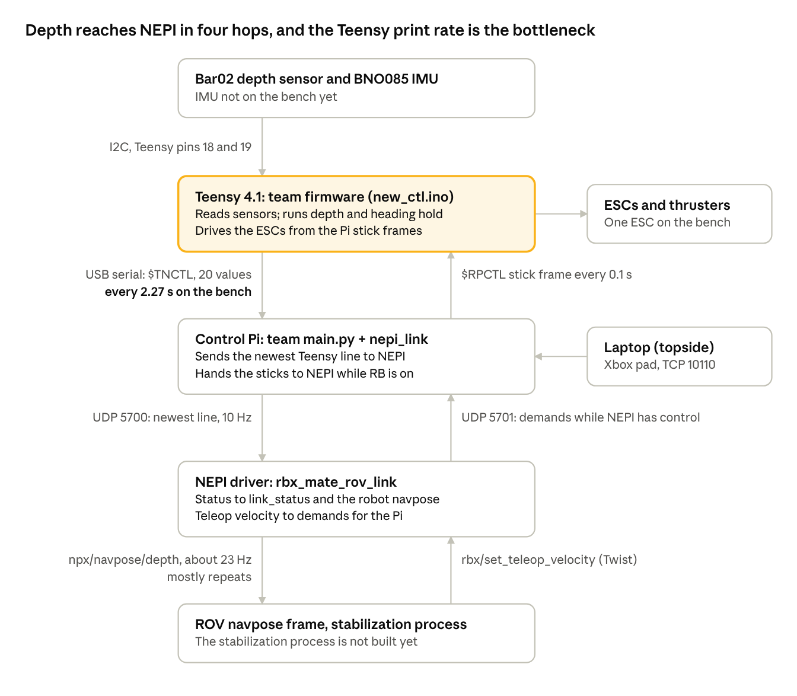

# MATE ROV Link Driver Handoff

As of 2026-10-23.

The rbx_mate_rov_link driver already carries the ROV's depth from its Teensy into NEPI's navpose on the bench. Your job is to fix the problems below and prove with tests that it delivers precise, current depth and orientation fast enough for the stabilization process.

## At a glance

Readings flow down the left side and commands flow up the right. The Teensy prints only every 50th loop, so NEPI gets a new reading every 2.27 s. In between, the driver repeats the last value.

## Targets

The stabilization process needs every new reading in NEPI within 100 ms, at least 20 times a second, stamped with when it was measured. Today the bench delivers one new reading every 2.27 s. The targets below are proposed; confirm them with the project owner before you start.

| Quantity | Bench now (measured 2026-10-23) | Target (proposed) |
| --- | --- | --- |
| New readings reaching NEPI | 0.42 per s (one Teensy line every 2.27 s) | 20 per s or more |
| Age of the newest reading in NEPI | median 1.13 s, 95th percentile 2.20 s | 95th percentile 100 ms or less |
| Depth resolution | 1 cm (the Teensy prints 2 decimals) | 1 mm or finer |
| Depth noise, sensor still in water | not measured | 2 mm RMS or less |
| Depth at the surface | 0.01 to 0.04 m in air (not zeroed) | 0.000 ± 0.005 m after zeroing |
| Reading timestamp | float32 Unix seconds, so 128 s steps | 1 ms or finer, the measurement time |
| Depth rate and angular rates | not passed on (depth rate always 0) | passed with every reading |
| Roll, pitch, yaw | all 0 (no IMU on the bench yet) | 0.1°, ENU, signs verified |
| Data after the link drops | last value repeated as if current | stopped or flagged within 250 ms |
| Malformed or dropped lines | 0 bad status messages | 0 in a 10-minute run |

Measured with `Nepi_Connect/tools/sample_link_rates.py` over 12 s. In that window the depth topic published 23.2 messages a second, and none of them carried a new value.

## Problems to fix

Ten problems stand between today's bench and the targets, listed by how much they matter to stabilization. Fix the ones marked "ours" freely. The team's firmware is theirs: agree changes with Victoria first, and try them on the bench copy.

| # | Problem | Where | Suggested fix | Code |
| --- | --- | --- | --- | --- |
| 1 | The Teensy sends a line only every 2.27 s | The bench sketch uses the stock BlueRobotics MS5837 library. The 45.5 ms loop fits its roughly 40 ms of waits per read (inferred from timing, not traced). The sketch also prints only every 50th loop (`SERIAL_TRANSMISSION_WRAP`, `new_ctl.ino:14`). On the team's ROV, a roughly 6 ms loop would still give only about 3 lines a second (computed). | Use a short conversion: the team's repo copy reads at OSR 256 with 0.6 ms waits (`rov-26/MS5837/MS5837.cpp:62-90`), but its `.h` does not match its `.cpp`. Print from a fixed 20 to 50 Hz timer instead of every 50th loop. | Bench copy now, team firmware later |
| 2 | The Teensy prints 2 decimal places | `Serial.print(double)` default in `transmit_rov_data()` (`new_ctl.ino:585-628`) | `Serial.print(value, 4)` for depth and the rates | Team firmware |
| 3 | The Pi forwards only the newest line, once every 100 ms | `STATUS_PERIOD_SEC = 0.1` (`nepi_link.py:120`); each status carries one `tn` | Send a status on every new Teensy line, keep 10 Hz as the floor for link health, and add a line counter so NEPI can count drops | Ours (`nepi_link`) |
| 4 | The driver republishes the last reading as if it were current | `getNavPoseCb` in `rbx_mate_rov_link_node.py` returns the last navpose once telemetry is older than `TN_MAX_AGE_MS` (500 ms). NPX republishes it about 23 times a second. | Publish only when a new line arrives. Past a staleness limit, stop and report it in `link_status`. Never return a blank navpose: `NavPoseIF` publishes the component topics whatever the `has_*` flags say, so a blank becomes depth 0. | Ours (driver) |
| 5 | Timestamps are float32 Unix seconds (128 s steps), and `header.stamp` is 0 | `float32 timestamp` and `time_*` fields in `nepi_interfaces` `NavPose*.msg` | This is an engine change that affects every NEPI device, so raise it with jseawall. Until it lands, the stabilization process should use receive time minus `tn_age_ms`. | NEPI engine |
| 6 | The measurement time is approximate | The driver sets time = now − `tn_age_ms`. That age starts when the Pi parsed the line, not when the Teensy sampled. | Add the Teensy's `millis()` to `$TNCTL`, or document the error (one Teensy loop plus serial delay) | Team firmware and ours |
| 7 | Depth rate and angular rates never reach NEPI | `getNavPoseCb` copies only `depth_m`, roll, pitch and yaw | Copy `depth_m_s` and the `*_deg_s` values from `tn` into the navpose rate fields | Ours (driver) |
| 8 | Depth is not zeroed | The Teensy's `depth()` assumes 1013 hPa at the surface, and density is fixed at 997 kg/m³ (`new_ctl.ino:249-250`) | A driver setting, "Zero depth", that stores a surface offset in its config | Ours (driver) |
| 9 | The depth frame is labelled MSL | The blank navpose default `frame_depth: 'MSL'` (`nepi_nav.py:219`) | Set `frame_depth` to `DEPTH` in the driver's navpose | Ours (driver) |
| 10 | The IMU path is untested, and the team code has two risks | Yaw comes from the game rotation vector, so it is relative and drifts. Yaw rate comes from gyro X (`new_ctl.ino:387`). `read_imu()` hangs if the BNO085 resets, because the sketch never calls `wasReset()`. | Check them when the IMU arrives (see Acceptance tests) and report results to the team | Team firmware |

Keep the `$TNCTL` line at exactly 20 values plus `*FF`: `nepi_link` drops any other line. If a fix changes the format, change `TN_NAMES` in `nepi_link.py`, `TN_VALUES` in the driver and `LINK_PROTOCOL.md` together. The navpose manager's ROV frame adds its own republish step, so consider having the stabilization process read the driver's topics directly.

## Where everything is

All the code is committed and pushed as of 2026-10-23: `mate_robotics` at `380d952` and `nepi_engine` at `7c2c062`. The one exception is `Nepi_Connect/tools/sample_link_rates.py`, which is new. Ask the owner how the driver gets deployed onto the NEPI box.

**Machines on the bench**

| Machine | Address | What runs there | How to reach it |
| --- | --- | --- | --- |
| Laptop (topside) | 192.168.68.12 | The team's `topside/modes/main.py` with the Xbox pad, and the dev repos | Local |
| Control Pi (Pi 5) | 192.168.68.22, user `nepidev` | The team's `rpi/modes/main.py` patched with `nepi_link` (`~/bench_fw/rpi`), and Teensy flashing (`~/bench_fw/new_ctl`) | No SSH. Copy files with `python3 -m http.server` on the laptop and `curl` on the Pi. |
| Teensy 4.1 | USB on the control Pi | The bench copy of `new_ctl.ino`: thrusters on, Bar02 on, IMU lines off | `arduino-cli` on the Pi |
| NEPI box (Jetson) | 192.168.68.23, also 192.168.179.103 | The NEPI container: the driver, the navpose manager, and the RUI on port 5003 | SSH as `nepihost` with the NEPI deploy key, then `docker exec` into the container. `sudo` needs the owner's password. |

**Code**

| Part | Path | Tests |
| --- | --- | --- |
| Driver | `mate_robotics/Drivers/rbx_drivers/rbx_mate_rov_link_node.py`, `_discovery.py`, `_params.yaml` | `Nepi_Connect/tools/test_rbx_mate_rov_link.py`: 26 pass |
| Pi bridge | `mate_robotics/Nepi_Connect/pi/nepi_link.py`, `nepi_link_bench.yaml`, `main_py_nepi_link.patch` | `Nepi_Connect/pi/test_nepi_link.py`: 71 pass |
| Bench tools | `Nepi_Connect/tools/fake_nepi.py` (stands in for NEPI), `sample_link_rates.py` (rates and ages) | |
| Team code | [rov-26](https://github.com/CoralCrusaders/rov-26): `mcu/modes/new_ctl/new_ctl.ino`, `rpi/modes/main.py`, `topside/modes/main.py` | |
| NEPI engine it uses | `nepi_api`: `device_if_rbx.py`, `device_if_npx.py`, `data_if.py` (`NavPoseIF`). `nepi_sdk/nepi_nav.py`. `nepi_managers/navpose_mgr.py`. | |

**Topics**, under `/nepi/device1/mate_rov_link_robot`:

- `rbx/set_teleop_velocity`: commands in, as a Twist with each axis from −1 to 1
- `link_status`: JSON with `link_up`, `tn_age_ms`, the assist state and `status_bad`
- `npx/navpose`, `npx/navpose/depth`, `npx/navpose/orientation`: data out
- `/nepi/device1/navposes/ROV/navpose`: the navpose manager's ROV frame, with the depth topic above as its depth source

**Bench rules**

1. Start the laptop script, then the Pi's `main.py`. After the Pi script stops, restart the laptop script first, because it accepts only one connection (`topside/modes/main.py:20`).
2. Before flashing, quit miniterm and the Pi script. Flash with `arduino-cli compile -u -b teensy:avr:teensy41 -p usb1/1-1 .`, using the port marked `teensy` in `arduino-cli board list`. Never use `/dev/ttyACM0`: it compiles but doesn't upload.
3. Keep the ESC supply off for sensor tests. Depth hold drives the vertical thrusters whenever RY is centred.
4. Don't trust a depth value without checking `tn_age_ms` in `link_status`. While the link is down, the driver repeats the last value.

## Acceptance tests

The driver is done when every box below is ticked on the bench. Record each result in the Bench Log of `Nepi_Connect/BENCH_SETUP_PLAN.md`.

- [ ] Unit tests pass: `python3 test_nepi_link.py` in `Nepi_Connect/pi` and `python3 test_rbx_mate_rov_link.py` in `Nepi_Connect/tools`, with a new test for every fix.
- [ ] Rate and age: `sample_link_rates.py` over 60 s shows 20 or more new lines a second, and a 95th-percentile `tn_age_ms` of 100 ms or less.
- [ ] No repeats: the depth topic's value changes roughly match the new lines, so each message carries a new reading.
- [ ] Resolution and noise: with the sensor face still in a bucket for 60 s, depth moves in 1 mm steps or finer, with an RMS of 2 mm or less.
- [ ] Accuracy: after zeroing, the sensor face at 10.0 cm and 20.0 cm under the surface (measured with a ruler) reads 0.100 and 0.200 m, each ± 0.005 m.
- [ ] Zero: "Zero depth" in air gives 0.000 ± 0.005 m and survives a driver restart.
- [ ] Link loss: stopping the Pi script stops or flags depth within 250 ms, and `link_status` shows the link down. Restarting the laptop script, then the Pi script, recovers without restarting NEPI.
- [ ] Start order: when the driver starts before the Pi, the depth topic appears once the Pi starts sending.
- [ ] NEPI restart: after a full NEPI restart, `/nepi/device1/navposes/ROV/navpose` has a publisher and shows depth.
- [ ] 10-minute soak: `status_bad` stays 0, and no gap between lines is longer than twice the nominal interval.
- [ ] Teleop still works: the bench plan's W/S, A/D and Q/E checks, plus stick takeover, RB off, Set State PILOT, and the Ctrl+\ timeout.
- [ ] IMU, when it arrives: a flat 90° counter-clockwise turn (seen from above) raises yaw by 90 ± 2° (ENU). Pitch and roll signs match NEPI's ENU convention in `nepi_nav.py`. The yaw-rate value is the one that moves in a flat turn. Unpowering the IMU doesn't freeze `$TNCTL`.

## Waiting on the team

This doc describes the bench as it stands on 2026-10-23. It will be updated when Victoria answers these questions:

1. The exact sketch on their Teensy now, and the Pi and topside scripts they run with it. Their repo is older than what is on the Teensy.
2. Which Teensy pin drives which thruster, and whether any are reversed.
3. Bar02 or Bar30, and fresh or salt water.
4. How the IMU is mounted: which way the board's X and Y arrows point.
5. What moves the claws, and whether NEPI should ever move them.
6. Whether a pressure/humidity/temperature sensor sits in the housing, and what reads it.
7. Whether their controller's triggers read 0 to 255 or 0 to 1023.
8. Whether the `NORMALIZE_TRIGGER` parentheses bug and the IMU-reset hang are in their current sketch.

Problems 1, 2 and 6 change the team's firmware and the `$TNCTL` format. Ask the team before changing their sketch, and keep any change to the bench copy until they agree.

## References

Read the first three before changing code. All paths are in the `mate_robotics` repo unless they say otherwise.

- `Nepi_Connect/BENCH_SETUP_PLAN.md`: bench steps, the Bench Logs for 2026-10-21 and 2026-10-23, and questions V1 to V11 for the team
- `Nepi_Connect/LINK_PROTOCOL.md`: the UDP contract between the Pi and NEPI. Where its text and `nepi_link.py` disagree, the code is current.
- `Nepi_Connect/README.md`: the design, and the team's answers so far
- `Docs/npx/bluerobotics_bar_depth_sensor.md`: Bar02 math, conversion times and resolution for each OSR
- `Docs/npx/adafruit_bno085_imu.md`: IMU modes and yaw drift
- `Docs/tbd/pjrc_teensy_4_1.md`: Teensy I2C pins and USB serial
- [rov-26](https://github.com/CoralCrusaders/rov-26): the team's code (local clone at `/home/production/rov-26`)
